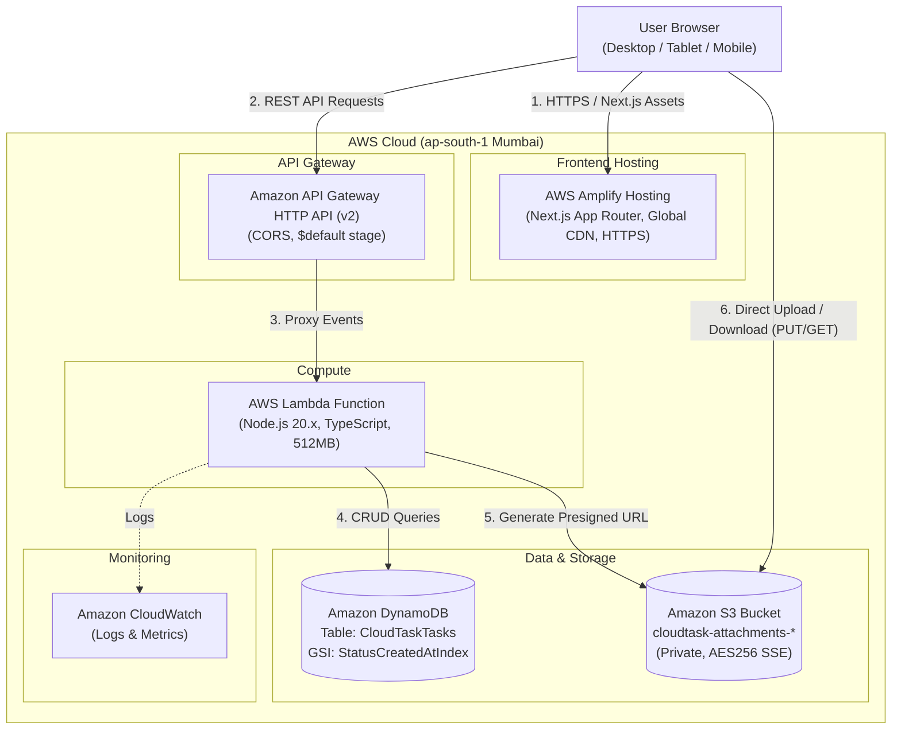
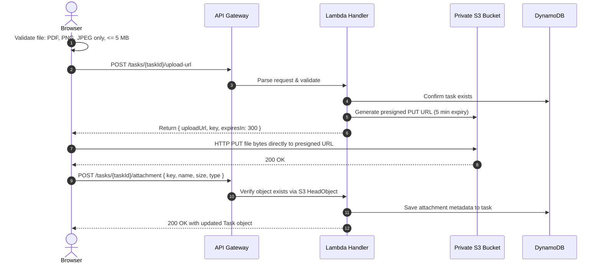

# CloudTask - Serverless Task & Document Management Platform

> **Candidate Assessment Submission**  
> **Role**: Junior Software Developer  
> **Company**: Cybernetics Software Pvt. Ltd.  
> **Evaluation Deadline**: 28 October 2026, 12:00 noon IST  
> **Target Region**: `ap-south-1` (Mumbai)  

---

## 1. Project Overview

**CloudTask** is a serverless SaaS task and document management web application. It combines a Next.js App Router frontend with an event-driven AWS serverless backend (API Gateway HTTP API, AWS Lambda, Amazon DynamoDB, and Amazon S3).

The application enables users to organize tasks across configurable statuses (`TODO`, `IN_PROGRESS`, `COMPLETED`) and priorities (`LOW`, `MEDIUM`, `HIGH`), while securely attaching documents (PDF, PNG, JPEG up to 5 MB) directly to a private, encrypted S3 bucket using short-lived AWS SigV4 presigned URLs.

### Key Highlights
- **100% Serverless**: Ephemeral compute with zero EC2 instances or persistent VMs.
- **Direct S3 Uploads**: File uploads bypass the Lambda execution layer via presigned S3 URLs, preventing timeouts and compute overhead.
- **Strict Validation**: Double-sided validation (browser and server) for file types, size ceilings (5 MB), and task attributes.
- **Least-Privilege Security**: Minimal IAM policy scopes and zero public S3 bucket access.
- **Fast Local & Cloud Development**: Built-in local development server and offline preview mode, alongside complete AWS SAM IaC deployment.

---

## 2. AWS Serverless Architecture



### S3 Direct Upload Flow



---

## 3. Technology Stack

| Layer | Technology | Description |
| :--- | :--- | :--- |
| **Frontend Framework** | Next.js 14 (App Router) | React 18, TypeScript, Server & Client Components |
| **Styling** | Tailwind CSS | Modern SaaS design, responsive cards, modals, badges |
| **Iconography** | Lucide React | Clean, consistent icons |
| **Hosting** | AWS Amplify Hosting | Continuous deployment from GitHub with HTTPS |
| **API Gateway** | Amazon API Gateway (HTTP API v2) | Low-latency, cost-effective serverless ingress |
| **Compute** | AWS Lambda | Node.js 20.x runtime, TypeScript compiled via `tsc` |
| **Database** | Amazon DynamoDB | On-demand billing (`PAY_PER_REQUEST`), GSI indexing |
| **Object Storage** | Amazon S3 | Private bucket, AES-256 SSE, Block Public Access |
| **Infrastructure as Code** | AWS SAM | Declarative CloudFormation template (`template.yaml`) |
| **Monitoring** | Amazon CloudWatch | Lambda logs and API execution metrics |
| **Target AWS Region** | `ap-south-1` (Mumbai) | Minimal latency for Indian infrastructure |

---

## 4. Repository Structure

```
cloud task/
├── backend/
│   ├── scripts/
│   │   └── smoke-test.ps1       # Automated PowerShell API smoke test suite
│   ├── src/
│   │   ├── aws-clients.ts       # DynamoDB DocumentClient & S3 presigner
│   │   ├── index.ts             # Main Lambda router with CORS & error handling
│   │   ├── local-server.ts      # Local Express dev server mimicking API Gateway
│   │   ├── task-service.ts      # Core CRUD service and S3 lifecycle logic
│   │   ├── types.ts             # Domain interfaces and request/response DTOs
│   │   └── validator.ts         # Input validation & sanitization functions
│   ├── tests/
│   │   ├── handler.test.ts      # Route & integration tests with mocked AWS SDK
│   │   └── validator.test.ts    # Unit tests for schemas and file constraints
│   ├── .env.example             # Backend environment variable template
│   ├── jest.config.js           # Jest configuration
│   ├── package.json             # Backend dependencies & scripts
│   ├── template.yaml            # AWS SAM Infrastructure as Code definition
│   └── tsconfig.json            # Backend TypeScript configuration
├── frontend/
│   ├── app/
│   │   ├── globals.css          # Global styling, Tailwind directives, variables
│   │   ├── layout.tsx           # Root layout with ToastProvider & SEO metadata
│   │   └── page.tsx             # Main dashboard, tab switcher & modal controllers
│   ├── components/
│   │   ├── architecture/        # In-app interactive architecture documentation
│   │   ├── dashboard/           # Real DynamoDB metrics and priority distribution
│   │   ├── documents/           # Dedicated S3 document repository view
│   │   ├── layout/              # Collapsible sidebar and responsive header
│   │   ├── tasks/               # Task table, card grid, create/edit/view modals
│   │   └── ui/                  # Toast notification system
│   ├── lib/
│   │   ├── api.ts               # API client supporting live AWS & offline demo
│   │   ├── types.ts             # Frontend domain models
│   │   └── utils.ts             # Formatting and class merging helpers
│   ├── .env.example             # Frontend environment variable template
│   ├── next.config.mjs          # Next.js configuration
│   ├── package.json             # Frontend dependencies & scripts
│   ├── tailwind.config.ts       # Tailwind CSS theme extension
│   └── tsconfig.json            # Frontend TypeScript configuration
├── docs/
│   └── architecture.md          # In-depth architectural & security specification
├── .gitignore                   # Monorepo gitignore rules
└── README.md                    # Project documentation & submission instructions
```

---

## 5. API Endpoints Specification

Base URL (when deployed): `https://{apiId}.execute-api.ap-south-1.amazonaws.com`

| Method | Endpoint | Description | Request Body | Response |
| :--- | :--- | :--- | :--- | :--- |
| `GET` | `/tasks` | List tasks with filtering & pagination | None (Query: `status`, `priority`, `search`, `limit`, `nextToken`) | `{ success: true, data: { tasks: [...], total, nextToken } }` |
| `POST` | `/tasks` | Create a new task (Server generates ID & timestamps) | `{ title, description?, priority?, status? }` | `{ success: true, data: TaskItem }` (201 Created) |
| `GET` | `/tasks/{taskId}` | Retrieve task (includes presigned download URL if attachment exists) | None | `{ success: true, data: TaskItem }` (200 OK) |
| `PUT` | `/tasks/{taskId}` | Update permitted task fields | `{ title?, description?, priority?, status? }` | `{ success: true, data: TaskItem }` (200 OK) |
| `DELETE` | `/tasks/{taskId}` | Delete task and delete associated file in S3 | None | `{ success: true, message: "Task deleted" }` (200 OK) |
| `POST` | `/tasks/{taskId}/upload-url` | Authorize file and return presigned PUT URL | `{ filename, contentType, size }` | `{ success: true, data: { uploadUrl, key, expiresIn } }` (200 OK) |
| `POST` | `/tasks/{taskId}/attachment` | Confirm S3 object existence and save metadata | `{ key, name, size, type }` | `{ success: true, data: TaskItem }` (200 OK) |

---

## 6. Environment Variables

### Frontend Configuration (`frontend/.env.local`)
Create `frontend/.env.local` by copying `frontend/.env.example`:

```bash
NEXT_PUBLIC_API_URL=https://your-api-id.execute-api.ap-south-1.amazonaws.com
```
*Note: If `NEXT_PUBLIC_API_URL` is omitted or empty, the frontend runs in offline preview mode with interactive mock storage.*

### Backend Configuration (`backend/template.yaml` & `backend/.env`)
Configured automatically during AWS SAM deployment:
- `TASKS_TABLE`: DynamoDB table name (`CloudTaskTasks`).
- `ATTACHMENTS_BUCKET`: Private S3 bucket name (`cloudtask-attachments-${AWS::AccountId}-${AWS::Region}`).
- `ALLOWED_ORIGIN`: Allowed CORS origin for frontend domain (`*` or Amplify URL).
- `AWS_REGION`: `ap-south-1`.

---

## 7. Local Development Guide

### Prerequisites
- Node.js 18.x or 20.x or 24.x
- npm 9+
- Windows PowerShell

### Step 1: Install Dependencies & Run Tests
Open Windows PowerShell:

```powershell
# 1. Install and test Backend
cd "c:\Users\nikhi\OneDrive\Desktop\cloud task\backend"
npm install
npm test
npm run build

# 2. Install and verify Frontend
cd "..\frontend"
npm install
npm run lint
npm run build
```

### Step 2: Run Full-Stack Locally
Run the local backend and frontend in separate PowerShell windows:

**Window 1 (Backend Local Server):**
```powershell
cd "c:\Users\nikhi\OneDrive\Desktop\cloud task\backend"
npm run local
# Running at http://localhost:5000
```

**Window 2 (Frontend Dev Server):**
```powershell
cd "c:\Users\nikhi\OneDrive\Desktop\cloud task\frontend"
# Point to local server in .env.local:
# NEXT_PUBLIC_API_URL=http://localhost:5000
npm run dev
# Open http://localhost:3000 in your browser
```

### Step 3: Run Automated Smoke Tests
With the local server running:
```powershell
cd "c:\Users\nikhi\OneDrive\Desktop\cloud task\backend"
powershell -ExecutionPolicy Bypass -File .\scripts\smoke-test.ps1 -BaseUrl "http://localhost:5000"
```

---

## 8. AWS Deployment Instructions (ap-south-1)

Follow these exact Windows PowerShell instructions to deploy CloudTask to your AWS account.

### Step 1: Install AWS CLI and AWS SAM CLI (if not already installed)
Run Windows Package Manager (`winget`):

```powershell
winget install Amazon.AWSCLI
winget install Amazon.SAM-CLI
```
*Restart PowerShell after installation to refresh the environment PATH.*

### Step 2: Configure AWS Credentials
Configure your AWS credentials with the target region set to `ap-south-1`:

```powershell
aws configure
# AWS Access Key ID [None]: <YOUR_ACCESS_KEY>
# AWS Secret Access Key [None]: <YOUR_SECRET_KEY>
# Default region name [None]: ap-south-1
# Default output format [None]: json
```

Verify your credentials and account identity:
```powershell
aws sts get-caller-identity
```

### Step 3: Build and Deploy the Backend with AWS SAM
From the repository root:

```powershell
cd "c:\Users\nikhi\OneDrive\Desktop\cloud task\backend"

# Compile TypeScript
npm run build

# Build SAM artifacts
sam build

# Deploy CloudFormation stack
sam deploy --guided `
  --stack-name cloudtask-backend `
  --region ap-south-1 `
  --capabilities CAPABILITY_IAM `
  --parameter-overrides AllowedOrigin="*"
```

When prompted:
- **Stack Name**: `cloudtask-backend`
- **AWS Region**: `ap-south-1`
- **Confirm changes before deploy**: `y`
- **Allow SAM CLI IAM role creation**: `y`
- **Disable rollback**: `n`
- **Save arguments to configuration file**: `y`

### Step 4: Capture Backend Outputs
After deployment completes, note down the `HttpApiUrl` from the CloudFormation outputs:
```
Key: HttpApiUrl
Value: https://abcdef123.execute-api.ap-south-1.amazonaws.com
```

Test the live API with the automated smoke test script:
```powershell
powershell -ExecutionPolicy Bypass -File .\scripts\smoke-test.ps1 -BaseUrl "https://abcdef123.execute-api.ap-south-1.amazonaws.com"
```

---

## 9. AWS Amplify Hosting Deployment Guide

### Option A: Deploy via GitHub & AWS Amplify Console (Recommended)

1. **Commit and Push Code to GitHub**:
   ```powershell
   cd "c:\Users\nikhi\OneDrive\Desktop\cloud task"
   git add .
   git commit -m "feat: complete CloudTask application with AWS SAM backend and Next.js frontend"
   git remote add origin https://github.com/<YOUR_GITHUB_USERNAME>/cloudtask.git
   git push -u origin main
   ```

2. **Open AWS Amplify Console**:
   - Go to [AWS Amplify Console (ap-south-1)](https://ap-south-1.console.aws.amazon.com/amplify/home?region=ap-south-1).
   - Click **Create new app** -> Select **GitHub**.
   - Authorize AWS Amplify to access your GitHub account.
   - Select your repository (`cloudtask`) and branch (`main`).

3. **Configure Build Settings**:
   - Set **App root** to: `frontend`
   - Amplify will automatically detect Next.js. Verify the build commands:
     ```yaml
     version: 1
     frontend:
       phases:
         preBuild:
           commands:
             - npm ci
         build:
           commands:
             - npm run build
       artifacts:
         baseDirectory: .next
         files:
           - '**/*'
       cache:
         paths:
           - node_modules/**/*
     ```

4. **Add Environment Variables in Amplify**:
   - In the **Environment Variables** section, add:
     - **Key**: `NEXT_PUBLIC_API_URL`
     - **Value**: `https://your-api-id.execute-api.ap-south-1.amazonaws.com` (from SAM output)

5. **Deploy and Verify**:
   - Click **Save and Deploy**.
   - Once the build succeeds, Amplify provides a public HTTPS URL:
     `https://main.dXXXXXXXXX.amplifyapp.com`
   - Open the URL in your browser and verify end-to-end task creation, status updates, and document upload to S3!

---

## 10. Security & Compliance Checklist

- [x] **No EC2 Instances**: 100% serverless on Lambda, DynamoDB, and S3.
- [x] **Zero Hardcoded Secrets**: No AWS credentials or secrets committed to git or exposed in browser code.
- [x] **Strict Private S3 Bucket**: All 4 public access blocks enabled.
- [x] **Short-Lived Presigned URLs**: S3 upload and download URLs are signed with SigV4 and expire in 5–15 minutes.
- [x] **Least-Privilege IAM Roles**: Function execution policy is strictly scoped to the `CloudTaskTasks` table and attachments bucket ARN.
- [x] **Server-Side File Validation**: Enforces MIME types (`application/pdf`, `image/png`, `image/jpeg`) and 5 MB file size limit on both client and server.
- [x] **Zero Stack Trace Leaks**: API Gateway returns sanitized JSON error messages and appropriate HTTP status codes (400, 404, 500).
- [x] **Assessment Scope Transparency**: Single-user assessment prototype clearly documented; multi-tenant authentication explicitly identified as a future extension.

---

## 11. Teardown & Resource Cleanup

To avoid unnecessary AWS charges after assessment evaluation:

```powershell
# 1. Empty the S3 attachments bucket
aws s3 rm s3://cloudtask-attachments-<AccountId>-ap-south-1 --recursive

# 2. Delete the AWS SAM CloudFormation Stack
cd "c:\Users\nikhi\OneDrive\Desktop\cloud task\backend"
sam delete --stack-name cloudtask-backend --region ap-south-1 --no-prompts

# 3. Delete Amplify App (if deployed)
# Delete via the AWS Amplify Console or AWS CLI
```

---

## 12. Assessment Submission Status

| Requirement | Status | Verification Detail |
| :--- | :--- | :--- |
| **Next.js App Router Frontend** | Completed | Clean TypeScript build (`npm run build`), zero lint errors |
| **AWS Lambda API Handler** | Completed | 20 unit tests passed (`npm test`), 0 lint warnings |
| **DynamoDB Persistence** | Completed | `CloudTaskTasks` table with `StatusCreatedAtIndex` GSI |
| **Private S3 File Uploads** | Completed | Double-sided validation (PDF, PNG, JPEG <= 5MB), presigned URLs |
| **Dashboard Metrics** | Completed | Live counts for total, pending, in-progress, completed, priority distribution |
| **AWS SAM Template** | Completed | `backend/template.yaml` configured for `ap-south-1` |
| **Documentation & Smoke Tests** | Completed | `docs/architecture.md`, `README.md`, `smoke-test.ps1` |
