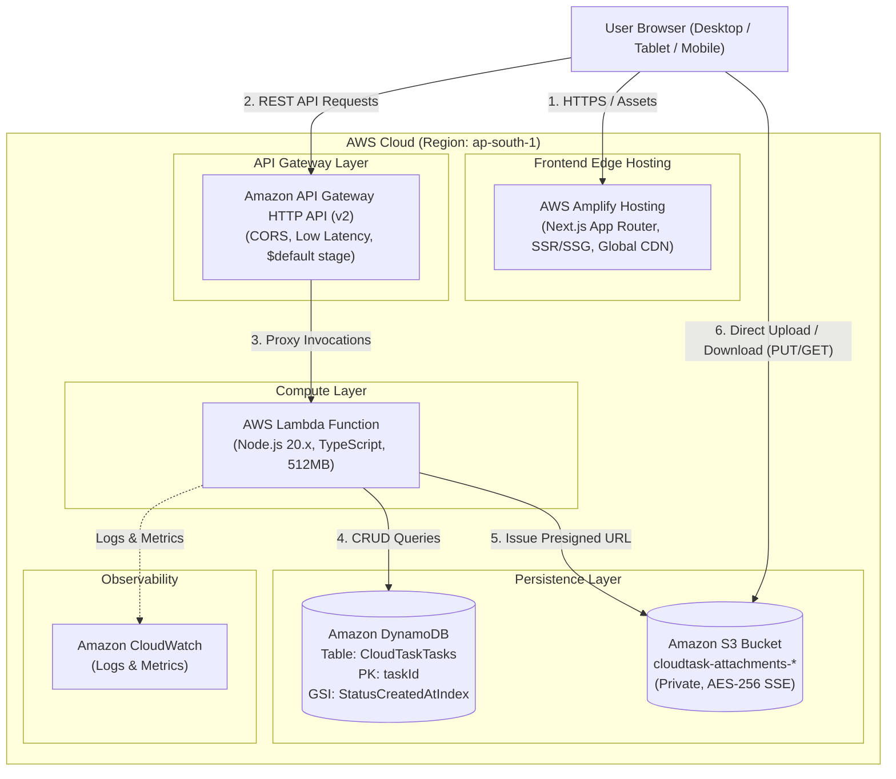
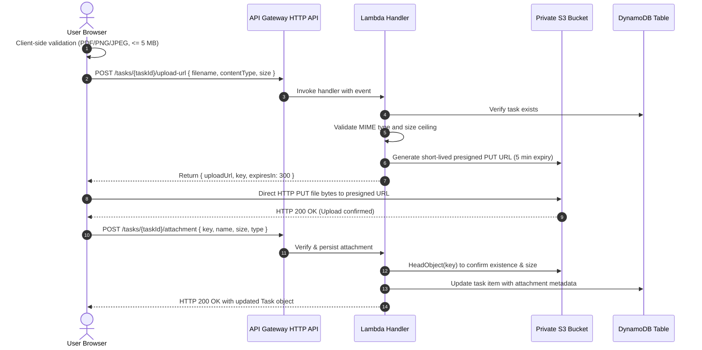

# CloudTask Architecture & Technical Specification

## 1. System Overview

CloudTask is a cloud-native, serverless task and document management web application. The system is designed around modern serverless patterns, strict security standards, least-privilege IAM permissions, and responsive user experience.

### Key Architectural Tenets
- **100% Serverless & Ephemeral**: Zero EC2 instances or persistent VMs. Idle cost is zero.
- **Direct-to-S3 Document Transfers**: File bytes never traverse the Lambda runtime, preventing memory bottlenecks, execution timeouts, and unnecessary compute costs.
- **Least-Privilege Security**: IAM roles are scoped to specific resource ARNs with minimal action sets. Public S3 access is blocked at the bucket level.
- **AWS Target Region**: `ap-south-1` (Asia Pacific - Mumbai) for minimal latency in India.

---

## 2. High-Level Architecture Diagram



---

## 3. Direct Document Upload Sequence (S3 Presigned URL)

To satisfy the 5 MB ceiling and support only PDF, PNG, and JPEG documents without proxying file streams through Lambda, CloudTask utilizes an authorized presigned URL pattern:



---

## 4. DynamoDB Data Model & Access Patterns

### Table Definition
- **Table Name**: `CloudTaskTasks`
- **Billing Mode**: `PAY_PER_REQUEST` (On-Demand billing, zero idle cost)
- **Partition Key (PK)**: `taskId` (String, e.g. `task_1730000000000_a1b2c3d4`)
- **Encryption**: AWS Managed Key (SSEEnabled: true)

### Secondary Index (GSI)
To support querying tasks by status without scanning the entire table:
- **Index Name**: `StatusCreatedAtIndex`
- **Partition Key**: `status` (String: `TODO` | `IN_PROGRESS` | `COMPLETED`)
- **Sort Key**: `createdAt` (String: ISO-8601 timestamp)
- **Projection**: `ALL`

### Access Patterns Supported

| Business Access Pattern | DynamoDB Operation | Key / Condition |
| :--- | :--- | :--- |
| Create new task | `PutItem` | PK: `taskId` |
| Retrieve task by ID | `GetItem` | PK: `taskId` |
| Update task details | `UpdateItem` | PK: `taskId` |
| Delete task | `DeleteItem` | PK: `taskId` |
| List tasks by status (sorted newest first) | `Query` on `StatusCreatedAtIndex` | PK: `status = :status`, `ScanIndexForward = false` |
| Filter by priority or title search | `Query` with `FilterExpression` | GSI Query + `contains(#title, :search)` |
| Paginate large datasets | `Query` / `Scan` with `Limit` | `ExclusiveStartKey` / `LastEvaluatedKey` |

---

## 5. Amazon S3 Security & Storage Architecture

### Security Controls
1. **Zero Public Access**:
   All 4 settings in `PublicAccessBlockConfiguration` are set to `true`:
   - `BlockPublicAcls: true`
   - `BlockPublicPolicy: true`
   - `IgnorePublicAcls: true`
   - `RestrictPublicBuckets: true`
2. **Server-Side Encryption**:
   - AES256 encryption applied to every object automatically (`SSEAlgorithm: AES256`).
3. **CORS Policy**:
   - Allowed Origins: Configured to frontend origin (or `*` during initial testing).
   - Allowed Methods: `GET`, `PUT`, `HEAD`.
   - MaxAge: 3600 seconds.
4. **Lifecycle Policy**:
   - Incomplete multipart uploads are aborted automatically after 1 day to prevent dangling storage costs.

---

## 6. Least-Privilege AWS IAM Policies

The Lambda function execution role is granted permissions strictly necessary for its operation:

```yaml
Policies:
  # DynamoDB Table and GSI access
  - Statement:
      - Effect: Allow
        Action:
          - dynamodb:GetItem
          - dynamodb:PutItem
          - dynamodb:UpdateItem
          - dynamodb:DeleteItem
          - dynamodb:Scan
          - dynamodb:Query
        Resource:
          - !GetAtt TasksTable.Arn
          - !Sub "${TasksTable.Arn}/index/*"

  # S3 Object access (restricted to the attachments bucket)
  - Statement:
      - Effect: Allow
        Action:
          - s3:PutObject
          - s3:GetObject
          - s3:DeleteObject
          - s3:HeadObject
        Resource:
          - !Sub "${AttachmentsBucket.Arn}/*"
```

---

## 7. Cost & Assessment Scope Analysis

- **AWS Free Tier Friendly**: All selected resources (Lambda 1M free requests/mo, DynamoDB 25GB free, S3 5GB free, API Gateway HTTP API 1M free requests) fall comfortably within AWS Free Tier terms.
- **No EC2 or NAT Gateways**: Eliminates hourly compute charges, VPC endpoint costs, or idling compute charges.
- **Single-User Assessment Notice**: As specified in the assessment requirements, this MVP is evaluated as a single-user system. Multi-tenant isolation and user authentication (e.g. Amazon Cognito or NextAuth) can be layered on top using the existing partition key architecture.
